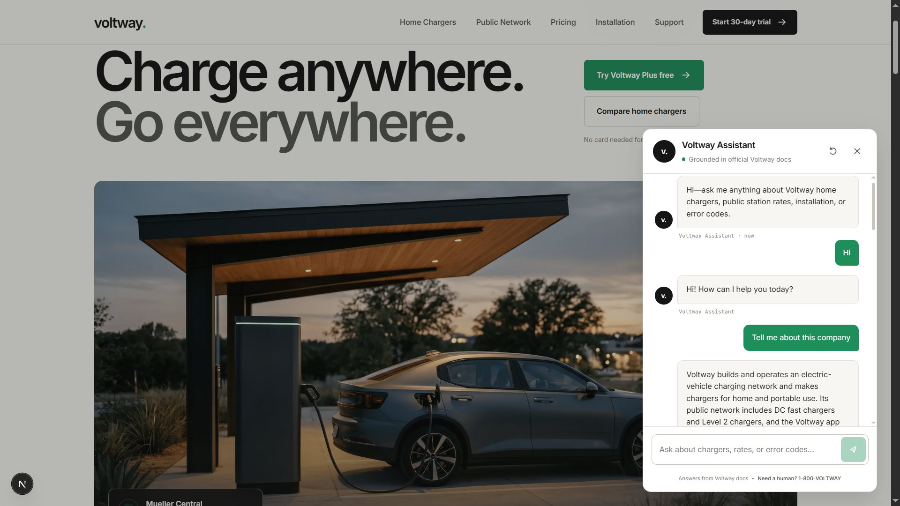

# Voltway RAG Chatbot

Voltway RAG Chatbot is an AI-powered support assistant for Voltway EV charging products and services. It retrieves information from a curated knowledge base to provide helpful, document-grounded answers about chargers, rates, installation, and troubleshooting.

The application combines a Next.js chat interface with a Mastra support agent, vector search backed by LibSQL, and Google embeddings.

## Tech stack

- **Next.js, React, and TypeScript** — web application and chat interface
- **Vercel AI SDK** — model integration and streamed chat responses
- **Mastra** — support agent and retrieval tools
- **LibSQL** — local vector storage for the knowledge base
- **Google Generative AI** — embeddings for document retrieval

## Run locally

### 1. Clone the repository

```bash
git clone https://github.com/towfeeqkhan/RAG-Chatbot.git
cd RAG-Chatbot
```

### 2. Configure environment variables

Create a `.env` file in the project root:

```env
TOKENHARBOR_API_KEY=your_tokenharbor_api_key
GOOGLE_GENERATIVE_AI_API_KEY=your_google_generative_ai_api_key
KNOWLEDGE_DB_PATH=/absolute/path/to/RAG-Chatbot/knowledge-base.db
```

- `TOKENHARBOR_API_KEY` authenticates the default chat model provider. If you use another provider, see [Choose a model provider](#choose-a-model-provider).
- `GOOGLE_GENERATIVE_AI_API_KEY` is used to create embeddings for retrieval. Create a key through [Google AI Studio](https://aistudio.google.com/). Availability and usage limits depend on Google's current terms.
- `KNOWLEDGE_DB_PATH` must be the **absolute path** to the included `knowledge-base.db` file. For example, on Windows use forward slashes: `C:/Users/your-name/path/to/RAG-Chatbot/knowledge-base.db`.

Keep `.env` private; it is excluded from Git.

### 3. Install dependencies

```bash
npm install
```

### 4. Choose a model provider

The default provider is configured in [`src/lib/ai.ts`](./src/lib/ai.ts):

```ts
import { createOpenAI } from "@ai-sdk/openai";

export const tokenHarbor = createOpenAI({
  baseURL: "https://tokenharbor.ai/v1",
  apiKey: process.env.TOKENHARBOR_API_KEY,
});

export const model = tokenHarbor("gpt-6-luna");
```

If you use the official OpenAI API, add `OPENAI_API_KEY` to `.env` and replace the contents of `src/lib/ai.ts` with:

```ts
import { openai } from "@ai-sdk/openai";

export const model = openai("gpt-4o");
```

For another OpenAI-compatible provider, add its API key to `.env` (for example, `YOUR_PROVIDER_API_KEY`) and configure its base URL and model:

```ts
import { createOpenAI } from "@ai-sdk/openai";

const yourProvider = createOpenAI({
  baseURL: "https://your-provider.example/v1",
  apiKey: process.env.YOUR_PROVIDER_API_KEY,
});

export const model = yourProvider("your-model-name");
```

When switching providers, use the corresponding environment variable in `src/lib/ai.ts`. The Google API key is still needed for embeddings, regardless of which chat model provider you choose.

### 5. Start the development server

```bash
npm run dev
```

Open [http://localhost:3000](http://localhost:3000) and start chatting with the Voltway RAG assistant.
